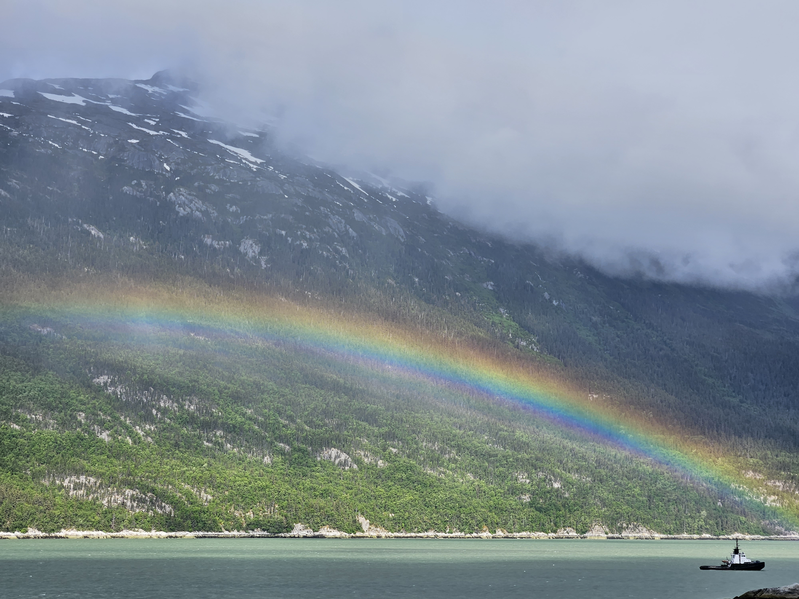
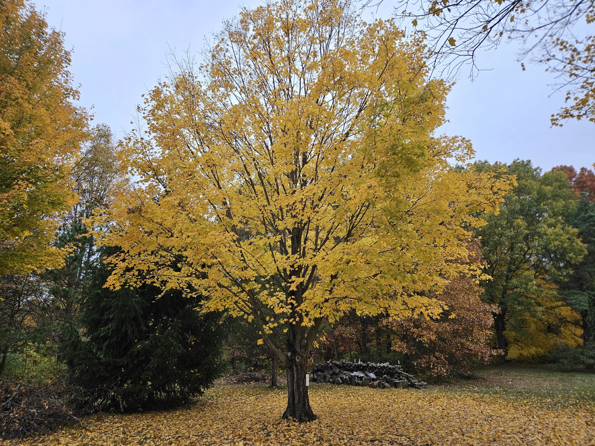

# bmpager Markdown Image Demo

This document demonstrates inline Unicode half-block TrueColor image rendering in `bmpager --markdown` using local images from `assets/wallpapers/`.

## 1. PNG Image (Relative Path)

## 2. JPEG Landscape

## 3. Autumn Canopy

## 4. Fallback Examples

Missing local files and remote URLs degrade cleanly without making network requests:

| Feature | Behavior |
| :--- | :--- |
| Local PNG / JPEG / WebP / GIF / BMP | Rendered inline via TrueColor `▀`/`▄` half-blocks with aspect-ratio scaling |
| `--no-color` | Falls back cleanly to `[Image: <alt> (<path>)]` |
| Missing or remote URL | Displays `[Image: <alt> (<url>)]` (clickable OSC 8 link for `http(s)://`) |
